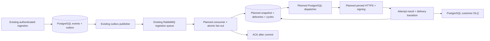

# HookRelay — Phase 3: Reliable Webhook Delivery Engine

## How to use this document

This document retains the original Steps 0–10 coding-agent prompts, final audit
prompt and Definition of Done. The completed Step 0 architecture is preserved in
[Architecture reference](#architecture-reference) below, reconciled against `1e22357`
on 2026-11-18 and integrated into these prompts on 2026-11-19.

Step 0 is complete as a design exercise. Steps 1–5 are implemented; Steps 6–10 remain
implementation work. Fan-out and delivery are disabled by default pending deployment-specific review.
See [Step 1 verification](PHASE_3_STEP_1_VERIFICATION.md),
[Step 2 rollout and verification](PHASE_3_STEP_2_VERIFICATION.md),
[Step 3 transport verification](PHASE_3_STEP_3_VERIFICATION.md),
[Step 4 signing verification](PHASE_3_STEP_4_VERIFICATION.md) and
[Step 5 dispatcher verification](PHASE_3_STEP_5_VERIFICATION.md).
Use the numbered prompts as the implementation sequence and the reference as their
shared technical contract. Read the reference before executing a prompt; the prompt
links identify the sections most relevant to that step. Preserve both parts when
updating this document. Proposed defaults are design decisions, not shipped behavior.

Do not enable outbound customer traffic before the transport, signing, lease/retry,
endpoint lifecycle and admission-control gates are verified. Steps 5–6 may exercise
workers with controlled receivers; later operational steps do not justify omitting
basic safety controls from the initial worker.

## Objective

Build the complete outbound webhook delivery system for HookRelay using the existing Java/Spring Boot, PostgreSQL and RabbitMQ infrastructure.

A customer must be able to publish an event to HookRelay and have that event reliably delivered as an authenticated HTTPS POST to every eligible subscribed endpoint.

The system must support durable delivery state, HMAC signatures, at-least-once delivery, retry scheduling, dead-lettering, manual replay, observability and tenant isolation.

**Phase 3 explicitly excludes the Next.js dashboard, payments, subscriptions/billing, SDK development, and production deployment.**

### Existing foundation

Source inspection for Step 0 confirmed the following existing foundation:

- Project-scoped API-key authentication.
- Event ingestion with idempotency.
- PostgreSQL event persistence.
- Transactional outbox publisher.
- RabbitMQ publishing with publisher confirms.
- Webhook endpoint CRUD and subscriptions.
- Signing-secret encryption and rotation.
- Registration-time SSRF validation.
- Tenant isolation, API rate limiting and request-size limits.

The architecture reference records the actual limitations, schema and code paths. Recheck the repository before implementation; this list is not evidence of runtime security verification.

### Architecture to implement

```text
Client Application
       |
       v
Event Ingestion API
       |
       v
PostgreSQL
  events + outbox
       |
       v
Existing OutboxPublisher
       |
       v
RabbitMQ: events.ingested notification
        |
        v
Event Consumer
        |
        v
Subscription Fan-out
        |
        v
PostgreSQL: deliveries (existing V1 table)
        |
        v
Delivery Dispatcher
        |
        v
SSRF-Safe HTTPS Client
        |
        v
Customer Webhook Endpoint
        |
        +-- 2xx --> DELIVERED
        |
        +-- Transient failure --> RETRY_SCHEDULED
        |
        +-- Permanent/exhausted --> DEAD_LETTERED
        |
        +-- Manual replay --> PENDING
```

PostgreSQL remains the source of truth for delivery status, attempt history and scheduled retries.

RabbitMQ handles event-consumer work distribution. The delivery dispatcher initially polls PostgreSQL for due work rather than introducing a second RabbitMQ delivery-job queue.

Migration version numbers follow the existing sequential convention starting at `V8`.

All asynchronous processing provides at-least-once semantics.

---

# Step 0 — Architecture Inspection and Design Decisions

### Goal

Understand the existing code and establish Phase 3 contracts before modifying production functionality.

### Coding-agent prompt

> Act as a principal backend architect preparing HookRelay for Phase 3.
>
> Read and follow [the full Architecture reference](#architecture-reference) in this document alongside AGENTS.md. Preserve the step prompts and reconcile any repository drift explicitly.
>
> Read `AGENTS.md`, the root-level `HOOKRELAY_OVERVIEW.md`, `docs/architecture.md`, `docs/openapi.yaml`, and all relevant existing application code.
>
> Inspect the existing event ingestion API, transactional outbox, RabbitMQ publisher, authentication, endpoint repositories, subscription logic, signing-secret encryption and SSRF policy.
>
> Document the actual implemented architecture, including database schema, event message format, queue topology, acknowledgements, configuration and package boundaries.
>
> Decide and document:
>
> 1. Delivery states and legal transitions.
> 2. Delivery uniqueness and idempotent fan-out rules.
> 3. Subscription selection semantics. For the MVP, prefer a snapshot of eligible active subscriptions at the first committed fan-out transaction. Clearly document that this snapshot occurs at fan-out processing time, not necessarily at ingestion time.
> 4. PostgreSQL-based delivery job scheduling.
> 5. Lease expiry and crash recovery.
> 6. HTTP timeout and retry policies.
> 7. Customer-visible DLQ versus RabbitMQ's internal dead-letter queue.
> 8. Webhook signing protocol and rotation semantics.
> 9. Endpoint deletion/disable behaviour.
> 10. Tenant isolation and data retention.
>
> Identify all existing code that can be reused and all necessary forward-only migrations.
>
> Review current official documentation before adding dependencies or using framework APIs. Preserve compatible versions and existing architectural conventions.
>
> Update the Architecture reference in `docs/PHASE_3_WEBHOOK_DELIVERY_ENGINE.md` with the architecture, decisions, risks and phased implementation plan. Preserve all step prompts, the final audit prompt and Definition of Done; reconcile their wording with the decisions instead of replacing the document.
>
> Do not implement the delivery engine in this step.
>
> Report important design uncertainties and any blockers.

**Acceptance:** The plan is reconciled with the actual repository, and the implementation approach is documented without introducing functional changes.

---

# Step 1 — Delivery Domain, State Machine and Persistence

### Goal

Create the durable foundation for individual webhook deliveries and attempts.

### Implementation status (2026-11-20)

V8–V11, the delivery domain and tenant-scoped JDBC stores now exist. The stores
atomically persist a supplied recipient snapshot, cycle 0 and immutable body bytes;
zero recipients also commit a final marker. They support fenced claim/start/result,
expiry recovery, cancellation and horizon expiry as persistence operations. No worker,
consumer, retry calculation, replay endpoint or outbound transport is enabled.

`FanoutStore` accepts internal recipient IDs; Step 2 must select eligible subscriptions
inside the same event-locked transaction. It must not select recipients at ingestion
or outside that transaction. Dispatch-control locks exist, but capacity/rate admission
and polling remain Step 5 work. Endpoint lifecycle reconciliation remains Step 7.

V8 deliberately refuses any legacy delivery/attempt history: historical destinations
cannot be reconstructed reliably. V10 needs no delivery backfill on the supported
empty-history upgrade path. Follow the [verification and rollout notes](PHASE_3_STEP_1_VERIFICATION.md)
before deployment. The original prompt below remains the acceptance contract.

### Selected delivery states

| State             | Meaning                                               |
| ----------------- | ----------------------------------------------------- |
| `PENDING`         | Created, awaiting first attempt                       |
| `IN_PROGRESS`     | Claimed by a delivery worker                          |
| `RETRY_SCHEDULED` | Waiting for the next attempt                          |
| `DELIVERED`       | Remote endpoint returned a successful response        |
| `DEAD_LETTERED`   | Delivery permanently failed or exhausted retry policy |
| `CANCELLED`       | Delivery intentionally stopped                        |

### Planned persistence changes

Phase 3 reuses the existing V1 `deliveries` and `delivery_attempts` tables via forward-only migrations starting at `V8`, rather than introducing duplicate `webhook_deliveries` / `webhook_delivery_attempts` tables.

**`deliveries` (V1, extended by V8)**

- `id` (existing PK)
- `project_id` (V8: added nullable UUID; backfilled and constrained in V10) — enables explicit tenant-scoped delivery queries and composite ownership FKs
- `event_id` (existing FK to events)
- `endpoint_id` (existing FK to endpoints)
- `status` (existing)
- `attempt_count` (existing)
- `next_attempt_at` (existing)
- `lease_owner` (V8: added text) — worker lease ownership
- `lease_token` (V8: added UUID) — fresh random token per claim, fencing stale completion
- `lease_expires_at` (V8: added timestamptz) — lease expiry for crash recovery
- `last_error_code` (V8: added text)
- Terminal timestamp, captured `destination_url`, cycle number/count/start/deadline and policy version/limits (V8 additions; see the complete migration plan)
- `created_at` (existing)
- `updated_at` (existing)

Constraints/indexes are staged through V10–V11 after backfill and validation:

- Foreign key to `projects` and composite project/resource FKs proving event/endpoint ownership.
- Existing `UNIQUE (event_id, endpoint_id)` preserves exactly one delivery per event/endpoint pair.
- Tenant-scoped due ordering and expired-lease partial indexes (extend V1's `idx_deliveries_due`).
- Project/status/time/ID history and endpoint/nonterminal lookup indexes.

**`delivery_attempts` (V1, extended by V8)**

- `id` (existing PK)
- `delivery_id` (existing FK to deliveries)
- `attempt_number` (existing)
- `started_at` (V8: added; backfill from existing `attempted_at`)
- `completed_at` (V8: added)
- `http_status` (existing)
- `duration_ms` (existing)
- `error_category` (V8: added text)
- `response_body` (existing nullable TEXT; write NULL for MVP, no response-preview capture by default)
- `error_code` (existing)
- `project_id`, `cycle_number`, `lease_token` (V8 additions)
- `outcome` (V8: added text)
- `attempted_at` (existing)

V9 adds `event_fanouts`, `delivery_cycles` and project/endpoint dispatch controls.
The abbreviated lists above are not standalone migration specifications; use
[the complete staged migration and retention plan](#10-decision-schema-evolution-and-retention).
V1 does not contain attempt start/completion timestamps or delivery leases.

Preserve historical delivery references when endpoints are soft-deleted (endpoints use `deleted_at`, not cascade delete).

### Coding-agent prompt

> Implement Phase 3 Step 1: delivery domain modelling and persistence.
>
> Read and follow [state machine and staged schema decisions](#10-decision-schema-evolution-and-retention) in this document alongside AGENTS.md. Preserve the step prompts and reconcile any repository drift explicitly.
>
> Read `AGENTS.md`, root `HOOKRELAY_OVERVIEW.md` and `docs/PHASE_3_WEBHOOK_DELIVERY_ENGINE.md`. Inspect existing migrations, database conventions, and repository patterns.
>
> Implement the durable delivery and delivery-attempt models using the project's established JDBC/transaction approach.
>
> Requirements:
>
> - Explicit delivery state machine and valid transitions.
> - Exactly one initial delivery per event/endpoint pair, enforced by database uniqueness.
> - Tenant-scoped read and write operations.
> - Persisted attempt history.
> - Safe status transitions under concurrency.
> - Lease owner/token and expiry support for future workers.
> - Efficient indexes for due-delivery polling.
> - Database timestamps and appropriate constraints.
> - Preserve historical delivery references when endpoints are soft-deleted.
> - No plaintext signing secrets or sensitive response headers stored.
> - Forward-only Flyway migrations.
>
> Implement the planned `event_fanouts` marker, immutable body storage, cycle history, composite ownership constraints and dispatch controls. Fan-out completion must commit atomically with delivery/cycle creation, including zero recipients, so duplicate messages cannot select later subscribers. Follow the V8–V11 expand/backfill/validate plan and stop for review if unexpected legacy delivery rows prevent a trustworthy backfill.
>
> Add unit and PostgreSQL Testcontainers integration tests covering constraints, lifecycle transitions, cross-tenant access, duplicate creation, concurrent updates and rollback.
>
> Do not implement RabbitMQ consumption, outbound HTTP requests or retries.
>
> Run `spotlessApply`, `clean check` and `bootJar`. Report actual results.

**Acceptance:** Delivery records and attempts are durable, tenant-safe and concurrency-safe.

---

# Step 2 — RabbitMQ Event Consumer and Subscription Fan-out

### Goal

Convert each successfully ingested event into individual endpoint delivery records.

### Implementation status (2026-11-20)

Implemented on `feat/event-fanout-consumer`: validated notifications, persisted identity
checks, set-based subscription snapshots, atomic cycles/body/marker creation, manual
ACK after commit, duplicate handling, bounded consumer recovery and operator
reconciliation. Endpoint creation now enforces the planned project cap under a lock.
The consumer remains disabled until a reviewed cutoff and broker/backlog policy are
configured. No outbound HTTP or delivery retry worker is enabled. See the
[rollout and verification record](PHASE_3_STEP_2_VERIFICATION.md). The prompt below
remains intact as the acceptance contract.

### Example

```text
Event: payment.succeeded
         |
         v
RabbitMQ
         |
         v
Event Consumer
         |
         +--> Endpoint A: Delivery 1
         +--> Endpoint B: Delivery 2
         +--> Endpoint C: Delivery 3
```

Each destination must have independent delivery state and attempts.

### Coding-agent prompt

> Implement Phase 3 Step 2: RabbitMQ event consumption and subscription fan-out.
>
> Read and follow [atomic fan-out and consumer recovery decisions](#3-decision-atomic-fan-out-snapshot) in this document alongside AGENTS.md. Preserve the step prompts and reconcile any repository drift explicitly.
>
> Read all project agent and architecture instructions. Inspect the existing `EVENT_INGESTED` outbox message contract, RabbitMQ topology and endpoint-subscription repositories.
>
> Implement a Spring AMQP consumer that:
>
> 1. Consumes the existing event messages.
> 2. Resolves the trusted project/event identity from persisted data.
> 3. Selects exact-match active subscriptions on enabled, nondeleted endpoints in one database snapshot at the first committed fan-out transaction—not at ingestion time.
> 4. Creates independent, durable `PENDING` deliveries for eligible endpoints.
> 5. Records fan-out completion, captured destination URLs, immutable body bytes and initial cycle 0 atomically with delivery creation.
> 6. Prevents duplicate fan-out on RabbitMQ redelivery.
> 7. Handles events with zero subscribed endpoints correctly.
> 8. Uses manual single-message acknowledgements only after the database transaction commits, including duplicate and zero-recipient results.
>
> Validate notification identity against persisted outbox/event records; the AMQP message ID is the outbox UUID. Enforce the planned endpoint-count bound and message-size cap. Review legacy rotation messages and historical-event rollout before activation.
>
> Do not make outbound HTTP requests from the RabbitMQ listener.
>
> Implement bounded consumer concurrency/prefetch and explicit handling for malformed or unprocessable messages. Avoid infinite immediate requeue loops. Use a bounded broker poison-message strategy with diagnostics.
>
> Preserve the distinction between the broker's operational DLQ and HookRelay's customer-visible delivery DLQ.
>
> Verify duplicate message delivery, consumer crashes, database failures, concurrent consumers, endpoint deletion, disabled endpoints and tenant isolation.
>
> Use RabbitMQ and PostgreSQL integration tests where infrastructure permits.
>
> Run all verification commands and document exact results.

**Acceptance:** One accepted event creates exactly one durable delivery for each eligible endpoint, regardless of duplicate consumer messages.

---

# Step 3 — SSRF-Safe Outbound HTTP Transport

### Goal

Create the secure HTTP client that will eventually send real webhooks.

This is the most security-sensitive step of Phase 3.

Registration-time SSRF validation is insufficient. The actual network connection must be made only to a validated destination.

### Coding-agent prompt

> Implement Phase 3 Step 3: a production-safe outbound webhook HTTP transport.
>
> Read and follow [HTTPS transport and retry policy](#7-decision-https-transport-and-retry-policy) in this document alongside AGENTS.md. Preserve the step prompts and reconcile any repository drift explicitly.
>
> Read the existing SSRF validator, DNS resolver, security ADRs, and project documentation.
>
> First, investigate the existing Java HTTP client options and verify which can safely bind outbound connections to validated DNS answers while preserving TLS hostname verification.
>
> Retain Spring `RestClient` for synchronous outbound HTTP with an explicitly selected request factory. Its underlying transport is classpath-dependent. Evaluate the selected Apache HttpClient 5 candidate through Spring's HttpComponents adapter, verifying the exact BOM-managed APIs, advisories, provenance and compatibility before adding a runtime dependency. A build-plugin dependency is not a runtime dependency. Prove connection-address pinning, TLS hostname verification and abortable total deadlines; a custom resolver alone is not proof. Do not replace this reviewed design or introduce WebFlux without a demonstrated need.
>
> Requirements:
>
> 1. Accept only HTTPS destinations on permitted ports, retaining the current port 443 restriction.
> 2. Resolve and validate every DNS address at connection time.
> 3. Reject mixed globally reachable and prohibited DNS answers.
> 4. Ensure the actual socket connects to an approved address with no second uncontrolled DNS resolution.
> 5. Preserve original-hostname SNI and certificate hostname verification.
> 6. Never disable TLS certificate validation.
> 7. Disable redirects by default.
> 8. Prevent unexpected proxy configuration from bypassing IP enforcement.
> 9. Enforce connect, response and overall request timeouts.
> 10. Bound response-body consumption.
> 11. Reject unsupported schemes, invalid authorities and dangerous IP representations.
> 12. Bound connections and concurrency; initially disable connection reuse and HTTP/2 coalescing as specified in the transport decision.
> 13. Release connections and other resources correctly, including cancellation during DNS/connect/TLS/upload/read; disable hidden retries, automatic authentication and cookies. Do not retain response bodies by default.
>
> Introduce a testable transport interface so HTTP behaviour can be tested without weakening production SSRF policy.
>
> Add deterministic tests for DNS rebinding, mixed DNS answers, private IPs, IPv6, timeouts, redirects, oversized responses, invalid TLS certificates, hostname mismatches and attempted unvalidated connections.
>
> Demonstrate with integration tests that DNS validation and the actual connection use the same approved address.
>
> Do not implement delivery scheduling or retry logic yet.
>
> Run all build verification commands and report remaining network-level protections required for deployment.

**Acceptance:** The transport cannot connect to an unvalidated destination, and normal TLS hostname verification remains effective.

---

# Step 4 — HMAC Signing Protocol

### Goal

Ensure customers can verify that webhook requests genuinely came from HookRelay and were not modified.

### Selected protocol

Use the exact [signing protocol and rotation decision](#8-decision-signed-webhook-protocol-and-rotation):
Standard Webhooks v1 HMAC wire construction, a stable delivery UUID as message ID,
and event identity in the immutable authenticated JSON body.

```http
webhook-id: aaaaaaaa-aaaa-4aaa-8aaa-aaaaaaaaaaaa
webhook-timestamp: 1790000000
webhook-signature: v1,<standard-padded-base64-HMAC-SHA256>
```

The signed bytes are `ASCII(deliveryId) + "." + ASCII(epochSeconds) + "." + rawBodyBytes`.
Decode the existing `whsec_` secret suffix as unpadded base64url to obtain the 32-byte
HMAC key; do not sign with the printable secret string. Preserve immediate secret
replacement and document in-flight overlap. Generic SDK key-format compatibility
requires tests. Do not introduce a competing proprietary header format.

### Coding-agent prompt

> Implement Phase 3 Step 4: versioned HMAC-SHA256 webhook request signing.
>
> Read and follow [signing protocol and rotation semantics](#8-decision-signed-webhook-protocol-and-rotation) in this document alongside AGENTS.md. Preserve the step prompts and reconcile any repository drift explicitly.
>
> Read existing signing-secret generation, encryption, decryption, rotation and key-version handling.
>
> Requirements:
>
> - Implement and document the exact signed byte construction selected in the Architecture reference; preserve immutable envelope bytes through retry and replay.
> - Sign the actual raw request bytes, not reconstructed JSON.
> - Include event identity, delivery identity and timestamp in the authenticated material.
> - Produce a fresh timestamp/signature for every delivery attempt.
> - Decrypt endpoint secrets only when required.
> - Never log plaintext secrets or signed payload internals unnecessarily.
> - Preserve the existing encryption-key-version compatibility model.
> - Document how webhook signing-secret rotation affects retries and replay.
> - Prevent delivery from endpoints with unavailable or invalid signing secrets.
> - Provide a reference verification example for customers using constant-time signature comparison and a configurable timestamp freshness window.
>
> Use the selected Standard Webhooks v1 wire construction and explicitly test/document HookRelay's existing base64url secret encoding. Preserve current immediate webhook-secret replacement, distinct from encryption-key rotation; do not claim server-side dual signing exists.
>
> Write deterministic tests using known HMAC test vectors, non-ASCII payloads, empty bodies, timestamp changes, modified payloads, wrong secrets and secret rotation.
>
> Integrate the signer with the outbound transport interface but do not start background delivery.
>
> Run all verification commands.

**Acceptance:** Webhook requests can be generated and independently verified using the documented signing protocol.

---

# Step 5 — Delivery Dispatcher, Worker and Lease Management

### Goal

Take persisted due deliveries and execute them safely and asynchronously.

### Recommended implementation

Use a scheduler to claim eligible delivery rows in bounded batches.

Conceptually:

```text
Scheduler wakes up
       |
       v
Find due deliveries
       |
       v
FOR UPDATE SKIP LOCKED
       |
       v
Persist worker lease
       |
       v
Commit claim transaction
       |
       v
Execute HTTPS request
       |
       v
Finalize attempt and outcome
```

Persist STARTED before transport; finalize it afterward. Never hold a database transaction open during the external HTTP request.

### Coding-agent prompt

> Implement Phase 3 Step 5: durable delivery scheduling and outbound execution.
>
> Read and follow [PostgreSQL scheduling, fencing and fairness](#6-decision-postgresql-scheduling-fencing-and-fairness) in this document alongside AGENTS.md. Preserve the step prompts and reconcile any repository drift explicitly.
>
> Read the delivery persistence layer, secure HTTP transport and HMAC signer.
>
> Implement a configurable Spring-based dispatcher that periodically claims a bounded batch of eligible deliveries from PostgreSQL.
>
> Requirements:
>
> 1. Claim due deliveries atomically using `FOR UPDATE SKIP LOCKED` or an equivalent proven database mechanism.
> 2. Persist a fresh random lease token per claim and require project/state/token/unexpired-lease predicates for ownership-sensitive writes.
> 3. Commit the claim before performing network I/O.
> 4. Claim only available execution capacity and enforce the selected fleet-wide project/endpoint concurrency and rate limits; no unbounded executor queue.
> 5. Recheck relevant endpoint state before starting transmission.
> 6. Build signed HTTPS requests using the previously implemented components.
> 7. Persist STARTED and increment lifetime/cycle attempt counts before HTTP; atomically finalize attempt, delivery, retry schedule and capacity release afterward.
> 8. Enforce legal state transitions.
> 9. Recover work abandoned by crashed workers.
> 10. Prevent stale workers from overwriting newer state.
> 11. Ensure timeout budgets and lease durations are consistent.
> 12. Support graceful shutdown.
>
> Document the unavoidable at-least-once duplicate-delivery window if a worker crashes after the receiver processes the request but before HookRelay commits the result.
>
> Follow the documented lock order and endpoint lifecycle checks from the first worker implementation. Keep customer dispatch disabled until Steps 6–7 integrate retry and lifecycle behavior; use controlled receivers for this step. A stale lease cannot update the database, but cannot guarantee cancellation of a remote side effect.
>
> Do not claim exactly-once remote execution.
>
> Add tests for parallel workers, empty queues, lease expiry, worker crashes, slow endpoints, stale lease completion, duplicate claims, database unavailability and graceful shutdown.
>
> Run all verification commands.

**Acceptance:** A pending delivery reaches its destination, records its attempt, and cannot be permanently stranded by a worker crash.

---

# Step 6 — Retry Engine, Backoff and Persistent DLQ

### Goal

Automatically recover from temporary endpoint failures and preserve permanently failed deliveries.
**Status: COMPLETE** — implemented in `com.hookrelay.delivery.application.DeliveryWorker`, `RetryScheduler`, `DeliveryStore`, and verified by unit + PostgreSQL integration tests.

### Selected default policy

| Result                             | Behaviour                                    |
|------------------------------------|----------------------------------------------|
| HTTP 2xx                           | Success (`DELIVERED`)                        |
| HTTP 408                           | Retry                                        |
| HTTP 429                           | Retry; bounded `Retry-After` honored         |
| HTTP 5xx                           | Retry                                        |
| Connection timeout/network failure | Retry                                        |
| SSRF policy violation              | Permanent failure (`SSRF_REJECTED`)          |
| DNS resolution failure             | Permanent failure (`DNS_FAILURE`)            |
| TLS/hostname failure               | Permanent failure (`TLS_FAILURE`)            |
| Most other HTTP 4xx                | Permanent failure                            |
| HTTP 3xx                           | Do not follow; treat as permanent failure    |
| Max attempts exhausted             | Dead-letter (`DEAD_LETTERED`)                |
| Retry horizon exceeded             | Dead-letter (`DEAD_LETTERED`)                |

Use the selected 8-attempt/24-hour cycle budget, equal jitter with a 10-second base and one-hour cap, bounded Retry-After, and the full outcome classification in the reference. Persist each cycle's policy version/limits; configuration must not silently expand existing budgets.

### Implementation notes

- `RetryScheduler` computes exponential backoff with equal jitter (`[cap/2, cap]`), clamps Retry-After to `maxSeconds`, combines via `max(jittered, retryAfter)`, and is overflow-safe for large attempt numbers. The jitter source is injectable for deterministic tests.
- `DeliveryWorker` classifies transport-level failures: SSRF/DNS/TLS are permanent (not retried); only `IOException`/connection failures are retryable. Transport duration is measured correctly (previously always zero). Retry-After hints are clamped before the `(int)` cast to avoid overflow.
- `DeliveryStore` persists `next_attempt_at`, `last_error_code`, `terminal_at`, and attempt history atomically. Dead-lettered deliveries (`DEAD_LETTERED`) are excluded from `listDue` and `claim`, never automatically retried, and are idempotent under concurrent terminalization.
- Crash/restart recovery uses `recoverExpired` (fenced lease expiry) and `expireHorizon` (cycle deadline exceeded → `DEAD_LETTERED`).
- Customer-visible DLQ = PostgreSQL rows in `DEAD_LETTERED` plus attempt/cycle history, independent of RabbitMQ's broker-level DLQ.

### Coding-agent prompt

> Implement Phase 3 Step 6: persisted retry scheduling and customer-visible dead-letter handling.
>
> Read and follow [bounded retry policy and outcome classification](#7-decision-https-transport-and-retry-policy) in this document alongside AGENTS.md. Preserve the step prompts and reconcile any repository drift explicitly.
>
> Read the delivery state machine, worker implementation and current configuration.
>
> Requirements:
>
> - Retry transient network failures, timeouts, 408, 429 and appropriate 5xx responses.
> - Treat most other 4xx responses as permanent failures unless the documented policy explicitly differs.
> - Use exponential backoff with jitter.
> - Bound backoff, attempt count and total retry horizon.
> - Parse and cap `Retry-After` safely.
> - Persist retry schedules in PostgreSQL.
> - Never sleep worker threads waiting for retry times.
> - Track actual attempt history.
> - Transition exhausted or permanently failed deliveries into a persistent `DEAD_LETTERED` state.
> - Preserve failure reasons and sanitized response metadata.
> - Ensure terminal deliveries are not reclaimed automatically.
> - Recover correctly after application restarts.
>
> Clearly distinguish customer-visible dead-lettered webhook deliveries from RabbitMQ's internal poison-message/DLX handling.
>
> Use an injectable clock and controlled jitter source for deterministic tests.
>
> Test every response classification, retry exhaustion, clock boundaries, restart recovery, concurrent workers and malformed `Retry-After` values.
>
> Do not implement customer-facing replay APIs in this step.
>
> Run all verification commands.

**Acceptance:** Temporary failures retry automatically and terminal failures remain inspectable instead of disappearing.

---

# Step 7 — Replay, Cancellation and Endpoint Lifecycle

### Goal

Make failed deliveries recoverable without compromising historical integrity.

### Coding-agent prompt

> Implement Phase 3 Step 7: manual delivery replay and lifecycle integration.
>
> Read and follow [endpoint lifecycle, replay and customer DLQ](#9-decision-endpoint-lifecycle-replay-and-customer-dlq) in this document alongside AGENTS.md. Preserve the step prompts and reconcile any repository drift explicitly.
>
> Read current endpoint soft-delete, enable/disable and signing-secret rotation semantics.
>
> Implement:
>
> 1. Manual replay of eligible dead-lettered deliveries.
> 2. Tenant-scoped replay authorization.
> 3. Idempotency protection against repeated/concurrent replay requests.
> 4. Replay audit records.
> 5. Preservation of all previous delivery attempts.
> 6. A fresh documented retry budget for replay, without erasing lifetime attempt history.
> 7. Cancellation of pending/retry-scheduled deliveries when an endpoint is deleted.
> 8. Explicit handling of disabled endpoints.
> 9. Explicit handling of already in-flight deliveries during deletion/disable.
> 10. Enforcement of signing-secret availability and current security policy on replay.
>
> Preserve one delivery per event/endpoint. Replay starts a new audited cycle on that delivery with a required project-scoped idempotency key; retain lifetime attempt numbers and use the captured URL, current secret and current security policy. Disabled endpoints pause queued work without extending its deadline; deletion fences and cancels it. Reuse the current APIs' lifecycle semantics and document unavoidable in-flight races. Step 7 implements the application service; Step 8 exposes its HTTP API.
>
> Design the replay state transitions to prevent duplicate concurrent scheduling.
>
> Document that a replay may deliver an event already processed by the receiver and that receivers must implement event/delivery idempotency.
>
> Add tests for duplicate replay, cross-tenant replay, deleted endpoints, disabled endpoints, successful deliveries, replay after secret rotation and concurrent replay requests.
>
> Run all verification commands.

**Acceptance:** Failed deliveries can be safely replayed, historical attempts remain intact, and deleted endpoints cannot silently resume receiving webhooks.

---

# Step 8 — Delivery History, Attempts and DLQ APIs

### Goal

Expose the delivery engine through a usable API before creating the dashboard.

### Suggested API surface

Adapt routes to the existing project's actual `/v1` conventions.

```http
GET  /v1/deliveries
GET  /v1/deliveries/{id}
GET  /v1/deliveries/{id}/attempts
POST /v1/deliveries/{id}/replay

GET  /v1/dead-letters
```

Use delivery detail for dead-letter detail. Reuse Step 7's replay service through one replay endpoint; do not duplicate its state machine or audit handling.

### Coding-agent prompt

> Implement Phase 3 Step 8: delivery history, attempt history, dead-letter listing and replay APIs.
>
> Read and follow [tenant-scoped recovery APIs](#9-decision-endpoint-lifecycle-replay-and-customer-dlq) in this document alongside AGENTS.md. Preserve the step prompts and reconcile any repository drift explicitly.
>
> Read existing controller patterns, authentication filters, ProblemDetail conventions, pagination and OpenAPI definitions.
>
> Implement tenant-scoped endpoints for:
>
> - Listing deliveries by status, event, endpoint and date range.
> - Retrieving one delivery.
> - Listing delivery attempts.
> - Viewing customer-visible dead-lettered deliveries.
> - Replaying an eligible delivery.
>
> Requirements:
>
> - All authorization derives from trusted tenant context.
> - Cross-tenant resources return 404.
> - Results are paginated with stable ordering and bounded page sizes.
> - Validation and errors follow existing API conventions.
> - No plaintext signing secrets, encryption ciphertext, sensitive headers or unbounded response bodies are exposed.
> - Replay writes have appropriate audit and abuse controls.
> - Response contracts match the current OpenAPI conventions.
>
> Add MockMvc and Testcontainers integration tests for positive and negative scenarios.
>
> Update `docs/openapi.yaml` and relevant developer documentation.
>
> Run all verification commands.

**Acceptance:** Customers can investigate deliveries, see why they failed and trigger authorized replay through the backend API.

---

# Step 9 — Backpressure, Fairness and Operational Observability

### Goal

Prevent failing endpoints or large customers from overwhelming the delivery infrastructure.

### Coding-agent prompt

> Implement Phase 3 Step 9: operational controls, backpressure and observability.
>
> Read and follow [retention, observability and rollout gates](#10-decision-schema-evolution-and-retention) in this document alongside AGENTS.md. Preserve the step prompts and reconcile any repository drift explicitly.
>
> Review the complete delivery pipeline and identify unbounded work, connection, memory and database contention risks.
>
> Requirements:
>
> - Configurable maximum global concurrent deliveries.
> - Configurable per-endpoint concurrency limits.
> - Bounded executor queues and connection pools.
> - Safe behaviour under database or broker outages.
> - Fair scheduling so one noisy endpoint/project cannot indefinitely starve others.
> - Limits on response size, attempt metadata and retained sensitive information.
> - Metrics for pending deliveries, in-progress deliveries, success/failure rates, latency, retry volume, dead-letter volume and lease recovery.
> - Structured logs with correlation IDs.
> - No secrets or full sensitive webhook payloads in logs.
> - Readiness/liveness design that does not accidentally expose administrative endpoints.
> - Graceful worker shutdown and cancellation behaviour.
> - Documented configuration defaults and operational tuning.
> - The approved retention/cleanup job, idempotency-expiry contract, backup/erasure requirements and historical-backlog rollout policy from the reference.
> - Load validation of the admission controls already required by Step 5; this step must not be the first introduction of basic dispatch bounds.
>
> Prefer existing Micrometer and Spring infrastructure. Do not introduce a new monitoring stack unless required.
>
> Use bounded-cardinality metric tags; avoid unrestricted event IDs, URLs and tenant IDs as metric labels.
>
> Add focused tests for concurrency limits, starvation risks, saturation, shutdown, lease-aware retention, replay near expiry and safe historical-backlog handling.
>
> Run all verification commands.

**Acceptance:** Delivery remains bounded, observable and recoverable under overload and dependency failures.

---

# Step 10 — End-to-End Integration Tests, Postman and Documentation

### Goal

Verify the whole event-to-webhook flow, not just individual components.

### Required end-to-end scenario

```text
1. Create endpoint
2. Create subscription
3. Publish event through ingestion API
4. Outbox publisher publishes to RabbitMQ
5. Consumer creates delivery
6. Worker claims delivery
7. HMAC signature is generated
8. HTTPS request is sent
9. Receiver verifies signature
10. Delivery and attempt records reflect the outcome
```

### Coding-agent prompt

> Implement Phase 3 Step 10: comprehensive end-to-end verification and documentation.
>
> Read and follow [required evidence and unresolved blockers](#12-phased-implementation-and-evidence-required) in this document alongside AGENTS.md. Preserve the step prompts and reconcile any repository drift explicitly.
>
> Read the entire Phase 3 implementation and all project agent instructions.
>
> Create integration tests covering the real event-to-delivery lifecycle with PostgreSQL, RabbitMQ and a controlled HTTPS test receiver.
>
> Do not globally disable production SSRF policy or TLS verification to make localhost tests pass. Use properly isolated test transport/resolver configuration and prove production wiring remains strict.
>
> Required scenarios:
>
> 1. Successful end-to-end delivery.
> 2. One event delivered to multiple endpoints.
> 3. One failing endpoint does not block another.
> 4. Invalid signature verification fails.
> 5. Duplicate event ingestion is idempotent.
> 6. RabbitMQ redelivery does not duplicate fan-out.
> 7. Network timeout schedules retry.
> 8. HTTP 429 respects bounded retry policy.
> 9. HTTP 5xx eventually succeeds after retries.
> 10. Permanent HTTP 4xx failure becomes dead-lettered.
> 11. Retry exhaustion becomes dead-lettered.
> 12. Manual replay succeeds.
> 13. Endpoint deletion cancels queued work.
> 14. Cross-tenant delivery access is rejected.
> 15. Worker crash and lease recovery.
> 16. Application restart preserves retry schedules.
> 17. Concurrent workers preserve database state integrity.
> 18. DNS rebinding and private-address SSRF attempts cannot reach prohibited destinations.
> 19. TLS hostname mismatch is rejected.
> 20. Secret rotation and replay behave according to the documented policy.
>
> Update both the comprehensive Postman API collection and the separate deployment smoke collection for all newly implemented HTTP APIs.
>
> Ensure smoke tests are repeatable and do not accumulate uncontrolled data.
>
> Run them twice against a running local development environment.
>
> Update OpenAPI, README, architecture documentation and a receiver signature-verification example.
>
> Run:
>
> - `./gradlew spotlessApply`
> - `./gradlew clean check`
> - `./gradlew bootJar`
>
> Run configured SBOM and vulnerability checks when their prerequisites are available. Report unavailable scans as NOT VERIFIED.
>
> Produce an exact execution report with passing, failing and skipped tests. Never invent results.

**Acceptance:** A real accepted event successfully travels through the outbox, RabbitMQ, consumer, database delivery worker and signed HTTPS request, with reliable retries, DLQ and replay.

---

# Phase 3 Final Verification

After completing Steps 0–10, run a separate independent review rather than relying only on the implementation agent's reports.

### Final audit prompt

> Act as an independent principal backend engineer, security auditor and reliability reviewer.
>
> Perform a comprehensive source-code and runtime audit of the completed HookRelay Phase 3 implementation.
>
> Verify the implementation against the Architecture reference in this document, including decisions and unresolved gates. Preserve the implementation prompts and completion checklist when updating documentation.
>
> Read `AGENTS.md`, `HOOKRELAY_OVERVIEW.md`, `docs/architecture.md`, `docs/PHASE_3_WEBHOOK_DELIVERY_ENGINE.md` and `docs/openapi.yaml`.
>
> Independently verify:
>
> 1. Event-to-delivery correctness.
> 2. Transactional outbox integration.
> 3. RabbitMQ consumer acknowledgements and duplicate handling.
> 4. Fan-out atomicity and subscription semantics.
> 5. Delivery database constraints and state transitions.
> 6. PostgreSQL worker claims, leases, fencing and crash recovery.
> 7. Actual socket-level SSRF prevention and TLS hostname verification.
> 8. HMAC signing protocol and secret rotation.
> 9. Retry policy, backoff and persistent customer-visible DLQ.
> 10. Manual replay, cancellation and endpoint lifecycle races.
> 11. Tenant isolation across every delivery API and worker query.
> 12. Backpressure, rate limits and resource exhaustion.
> 13. Sensitive-data exposure, logging and metrics.
> 14. Database migrations, including upgrades from the Phase 2 schema.
> 15. Dependency, container and build reproducibility.
> 16. End-to-end integration tests and repeatable Postman smoke tests.
>
> Inspect actual code paths rather than accepting existing tests at face value.
>
> Add regression tests for defects. Fix genuine Phase 3 defects without adding unrelated features.
>
> Run the full build, relevant security checks and real runtime integration tests.
>
> Classify every finding as Critical, High, Medium or Low.
>
> Do not claim a security control is verified unless its actual enforcement has been tested.
>
> Create `docs/PHASE_3_FINAL_VERIFICATION.md`, including:
>
> - PASS / CONDITIONAL PASS / FAIL verdict.
> - Full verification matrix.
> - Code changes and regression tests.
> - Runtime and Postman test results.
> - Security findings and residual risks.
> - Explicit at-least-once delivery limitations.
> - Production-readiness blockers.
> - Whether Phase 4 can begin.
>
> Do not manufacture passing test results or conceal environmental limitations.

---

# Definition of Done — Phase 3

Phase 3 is complete when:

- [ ] Events fan out reliably to subscribed endpoints.
- [ ] Every delivery and attempt has durable database state.
- [ ] Duplicate messages cannot create duplicate initial delivery records.
- [ ] HTTPS requests use validated, pinned destinations and proper TLS hostname verification.
- [ ] Each webhook is signed using the documented protocol.
- [ ] Multiple workers can process deliveries safely.
- [ ] Failed deliveries retry according to a persisted policy.
- [ ] Permanent/exhausted failures enter the customer-visible DLQ.
- [ ] Authorized customers can inspect and replay failed deliveries.
- [ ] Soft-deleted and disabled endpoint behaviour is enforced.
- [ ] Tenant isolation holds throughout the asynchronous pipeline.
- [ ] The delivery engine remains bounded under overload.
- [ ] Runtime integration tests and repeatable Postman smoke tests pass.
- [ ] Critical and High findings are resolved.
- [ ] OpenAPI and architecture documentation reflect the implementation.
- [ ] The final verification report is complete.

**Completion does not mean production deployment is approved.** Infrastructure egress controls, secrets management, vulnerability scanning, operational readiness and deployment hardening must also be verified before exposing the service publicly.

---

# Architecture reference

Status: Step 0 design reference, reconciled on 2026-11-18 against commit `1e22357`.
Integrated with the preserved Steps 0–10 prompts on 2026-11-19. No consumer, dispatcher,
HTTP client, migration, dependency or public API is introduced by this document.

Read alongside [AGENTS.md](../AGENTS.md), the product intent in
[HOOKRELAY_OVERVIEW.md](../HOOKRELAY_OVERVIEW.md), existing
[architecture decisions](architecture.md) and [OpenAPI](openapi.yaml).
“Current” below means inspected source; “Decision” means required future behavior.
Defaults in this plan are proposed MVP policy, not existing configuration or an SLA.

## 1. Scope and constraints

Retain one Spring Boot deployment, imperative Spring MVC, JDBC, PostgreSQL as the
source of truth, and RabbitMQ for ingestion notifications. PostgreSQL schedules
HTTP work; no second delivery queue, Redis, Quartz, reactive stack or microservice.
At-least-once processing permits duplicate HTTP requests and does not promise
successful delivery to an unavailable receiver. There is no event ordering guarantee.

The overview places some recovery features in Phase 4. This plan includes the minimum
persistent DLQ, inspection, replay, retention and resource limits needed to operate
Phase 3 responsibly; dashboard, billing, SDKs and production deployment remain excluded.

Preserve Java 25, Boot 4.1.2, Framework 7.0.10, Spring AMQP 4.1.2, Jackson 3.1.7,
Gradle 9.9.1, PostgreSQL 18.7 and RabbitMQ 4.4.0. Existing locked build plugins and
BOM ownership remain unchanged. A build-plugin dependency is not automatically an
application runtime dependency.



## 2. Actual implementation

### 2.1 Packages and reusable boundaries

Paths below are relative to `backend/src/main/java/com/hookrelay/`.

| Existing code                                                                              | Actual responsibility and Phase 3 reuse                                                                                                                                                                           |
|--------------------------------------------------------------------------------------------|-------------------------------------------------------------------------------------------------------------------------------------------------------------------------------------------------------------------|
| `auth/ApiKeyAuthenticationFilter`, `ApiKeyAuthService`, `TenantContext`, `ProjectIdentity` | `X-Api-Key` authentication, project/organization identity, request-scoped thread-local cleared in `finally`. Reuse at delivery API boundaries; never propagate the thread-local to workers.                       |
| `auth/AuthenticationEntryPoint`, `ApiKeyAuthenticationEntryPoint`                          | Project-owned interface/component producing 401 problem JSON; this is not an installed Spring Security filter chain.                                                                                              |
| `auth/ProjectRateLimiter`, `RateLimitProperties`                                           | Atomic PostgreSQL fixed-window request admission. Reuse the pattern, not the same bucket, for replay/dispatch limits.                                                                                             |
| `event/api`, `event/application/EventIngestionService`                                     | HTTP ingestion, validation, canonical request fingerprint and atomic event/outbox writes. Preserve the 202 contract. No event repository exists yet.                                                              |
| `outbox/OutboxStore`, `OutboxPublisher`                                                    | Short claim transactions, network publishing after commit, confirms/returns, publish retries. Reuse the transaction pattern; delivery needs a fresh token per claim, unlike the current publisher-instance owner. |
| `endpoint/api`, `endpoint/application`, `endpoint/repository`, `endpoint/domain`           | Tenant-scoped CRUD, URL normalization, subscription mutation, endpoint row locking. Add a focused recipient-selection query; existing subscription lookup methods are endpoint-centric, not fan-out queries.      |
| `security/SigningSecretService`, `AesGcmSigningSecretService`, `SigningProperties`         | Secret generation/encryption/decryption and encryption keyring. No HMAC request signer exists.                                                                                                                    |
| `security/ssrf/*`                                                                          | Registration URL/address policy and bounded DNS resolution. Reuse policy after extracting test-covered address validation; the current `void validate(url)` neither returns nor pins connection addresses.        |
| `common/ApiExceptionHandler`, `RequestBodySizeLimitFilter`                                 | Error conventions and bounded body reading. Keep new business logic in feature packages; existing `common` advice already imports feature exceptions, so do not pretend package independence is fully enforced.   |
| `config/RabbitMqConfiguration`, `FilterConfiguration`, `HookRelayApplication`              | Topology, filter order and scheduling enablement; configuration only.                                                                                                                                             |
| `delivery`, `dlq`, `billing`, `organization`, `project`                                    | Package placeholders, not implemented business services. No `retry` implementation exists.                                                                                                                        |

Add `delivery.api/application/domain/repository/transport` as needed; keep retry policy
inside `delivery` initially. A consumer adapter calls a fan-out service. A dispatcher
calls delivery orchestration and a narrow HTTPS transport. No domain decisions in
controllers, listener configuration or SQL row mappers. `dlq` can initially be a
filtered delivery query rather than another persistence subsystem.

### 2.2 Authentication, ingestion and endpoint APIs

`ApiKeyAuthService` recognizes `hr_live_<prefix>_<secret>`, looks up a unique prefix,
compares the SHA-256 hash of the full key in constant time, checks revocation and
updates `last_used_at` with a project predicate. Identity comes from `api_keys JOIN
projects`, never a request project ID. No dashboard user roles or API-key management
API exist. The `local` profile alone seeds an organization/project/key.

For ordinary `/v1/` paths, authentication precedes project rate limiting and body
reading. The filters currently decide applicability using the raw URI prefix;
encoded/semicolon path variants require explicit regression coverage before new
APIs are exposed. `TenantContext.require()` remains a controller authorization guard.

`POST /v1/events` accepts `{ "eventType": "payment.succeeded", "data": {...} }`.
The event type is at most 128 characters matching `[a-z0-9]+([._-][a-z0-9]+)*`;
data must be an object. Optional `Idempotency-Key` is 1–128 characters matching
`[A-Za-z0-9._:-]+`. Object keys are recursively sorted, array order preserved, and
SHA-256 computed over `eventType + "\n" + serializedData`. This is the existing
fingerprint algorithm, not a general JSON canonicalization standard.

The transaction inserts `events` using the partial project/key unique index, then
an `EVENT_INGESTED` outbox row. On key collision it reads the same project's event:
equal fingerprint returns the original ID; different content returns 409. No key
means a new event each time. A committed 202 contains `eventId`, `createdAt`,
`status=ACCEPTED`, `Idempotent-Replayed` and `Cache-Control: no-store`.
It does not mean fan-out or HTTPS delivery happened.

Current payload limit is 262,144 serialized UTF-8 bytes; whole request limit is
270,336 bytes. Oversize serialized data currently throws `IllegalArgumentException`
(400), although OpenAPI's shared 413 response includes it. Text-value NUL checking
exists, but JSON field-name NUL handling also needs coverage. These are contract/input
follow-ups, not functional changes in this plan.

Endpoints support create/list/get/PATCH/delete, enable/disable and rotate-secret;
subscriptions support GET list and idempotent PUT/DELETE by exact event type.
Lists use page/size, default 20, maximum 100, stable timestamp/UUID ordering.
There are no wildcards, event-read, delivery-read, replay or customer DLQ APIs yet.
An endpoint may have active subscription rows while disabled; eligibility must test both.

Metadata/enable/disable/rotation/subscription mutations serialize on the scoped
endpoint row. DNS checks precede write transactions. Deletion only sets endpoint
`deleted_at`; it does not delete subscription rows, clear secrets or cancel work.
Queries hide subscriptions through their deleted parent. URL identity preserves
path/query case and escaped bytes, normalizes scheme/host/default port/empty path,
and currently also enforces a 2,000-byte canonical URL cap beyond the DTO's
2,048-character limit. OpenAPI does not yet describe that byte cap.

### 2.3 Database after V1–V7

All IDs are UUIDs; timestamps are `timestamptz`. Inspect the append-only source in
[`db/migration`](../backend/src/main/resources/db/migration).

| Table                    | Implemented columns/constraints relevant to Phase 3                                                                                                                                                                                                                               |
|--------------------------|-----------------------------------------------------------------------------------------------------------------------------------------------------------------------------------------------------------------------------------------------------------------------------------|
| `organizations`          | `id`, `name`, `created_at`.                                                                                                                                                                                                                                                       |
| `projects`               | Organization FK, name, constrained environment, creation time; unique organization/name/environment.                                                                                                                                                                              |
| `api_keys`               | Project FK, unique `key_prefix`, `key_hash`, name, creation/last-use/revocation timestamps.                                                                                                                                                                                       |
| `endpoints`              | Project FK, URL, description, ciphertext, nonce, encryption key version, enabled flag, creation/update/deletion times. Partial unique `(project_id,url)` for nondeleted endpoints; enabled-secret structural check.                                                               |
| `endpoint_subscriptions` | Endpoint FK, event type, creation/deletion times; partial unique `(endpoint_id,event_type)` for nondeleted rows. Project ownership is obtained by joining endpoints. Physical endpoint deletion cascades subscriptions.                                                           |
| `events`                 | Project FK, event type, object JSONB payload, nullable idempotency key, request fingerprint, creation time. Partial unique project/idempotency key; project/time and project/type/time indexes. No fan-out marker.                                                                |
| `outbox_messages`        | Project FK, aggregate UUID (no event FK), type constrained to `EVENT_INGESTED`, object JSONB payload, `PENDING/IN_FLIGHT/PUBLISHED`, publish count, available/lease/create/publish times, owner and error. Claimable partial index and aggregate index.                           |
| `deliveries`             | **Existing unused V1 table:** ID, event and endpoint FKs, unconstrained status, attempt count, next due/create/update times; unique `(event_id,endpoint_id)` and partial due index for `PENDING/RETRY_SCHEDULED`. No project column, lease, terminal timestamps or status checks. |
| `delivery_attempts`      | **Existing unused V1 table:** ID, delivery FK with delete cascade, attempt number, HTTP status, unbounded nullable `response_body`, error code, duration, `attempted_at`; unique delivery/attempt number. **No `started_at` or `completed_at` columns.**                          |
| `endpoint_audit_events`  | Project/endpoint FKs, action constrained to `SECRET_ROTATED`, timestamp; no secret material. Not a generic replay-audit table.                                                                                                                                                    |
| `project_request_limits` | One row/project, window end and positive request count, project delete cascade.                                                                                                                                                                                                   |

V2 adds soft deletion and active subscription uniqueness; V3 adds a case-insensitive
URL index; V4 adds encryption nonce/version; V5 replaces the URL identity/index;
V6 separates rotation audits from outbox and disables legacy unsigned endpoints;
V7 adds shared request admission. Delivery FKs currently do **not** prove that event
and endpoint belong to the same project. Do not recreate the V1 delivery tables.

### 2.4 Event notification and RabbitMQ topology

Current persisted/published JSON has no explicit schema-version or message-type field:

```json
{
  "eventId": "aaaaaaaa-aaaa-4aaa-8aaa-aaaaaaaaaaaa",
  "projectId": "bbbbbbbb-bbbb-4bbb-8bbb-bbbbbbbbbbbb",
  "eventType": "payment.succeeded",
  "data": {"paymentId": "synthetic-example"},
  "createdAt": "2026-11-18T00:00:00Z"
}
```

`EventIngestionService.EventIngestedMessage` creates this envelope; JSONB is read back
as text by `OutboxStore`, so original request bytes are not preserved. The publisher
sends UTF-8 JSON, persistent delivery mode and `application/json`. AMQP `messageId`
and correlation ID are the **outbox UUID**, not the event UUID. `EVENT_INGESTED`
is a database discriminator; it is not currently an AMQP type header.

| Object                          | Current declaration                                                    |
|---------------------------------|------------------------------------------------------------------------|
| `hookrelay.events`              | Durable, non-auto-delete topic exchange.                               |
| `hookrelay.events.ingested.v1`  | Durable queue, binding `events.ingested`; DLX/routing arguments below. |
| `hookrelay.events.dlx`          | Durable, non-auto-delete direct exchange.                              |
| `hookrelay.events.ingested.dlq` | Durable queue, bound with `events.ingested.dlq`.                       |

No explicit queue type, message TTL, queue length/byte cap or overflow policy is
configured. Queue type is broker/default-dependent; this source does not establish
quorum replication. There is no `@RabbitListener`, consumer acknowledgement policy,
prefetch or listener retry policy. Test `RabbitTemplate.receive` calls are not a
production consumer.

The publisher loops up to 25 times per poll, claiming **one** row each time with
`FOR UPDATE SKIP LOCKED` in a short transaction, including expired in-flight rows.
It commits, sends, waits for an affirmative correlated confirm and checks mandatory
returns, then conditionally marks published using ID/status/owner. Failure releases
for exponential publish retry with positive jitter capped at 60 seconds; no maximum
publish count. Lease expiry recovers crashes. Broker acceptance before the DB mark
can duplicate publication. Publisher confirms do not acknowledge consumer processing
([RabbitMQ 4.4 acknowledgements](https://www.rabbitmq.com/docs/confirms)).

V6 cannot remove old `SECRET_ROTATED` messages already in RabbitMQ. Inspect and
quarantine those before activating ingestion consumption.

### 2.5 Current configuration and secret storage

| Setting                                                                                         | Current default / behavior                                                                                                                            |
|-------------------------------------------------------------------------------------------------|-------------------------------------------------------------------------------------------------------------------------------------------------------|
| `hookrelay.outbox.enabled`, `scheduling-enabled`                                                | Both true; polling fixed delay 1,000 ms.                                                                                                              |
| `hookrelay.outbox.batch-size/lease-seconds/confirm-timeout-seconds/max-publish-backoff-seconds` | 25 / 30 / 5 / 60.                                                                                                                                     |
| `spring.rabbitmq`                                                                               | Connect timeout 5 s; correlated confirms, returns and mandatory publishing enabled.                                                                   |
| `hookrelay.events.max-payload-bytes`, `hookrelay.http.max-request-bytes`                        | 262144 / 270336; server header cap 8 KiB.                                                                                                             |
| `hookrelay.rate-limit`                                                                          | 1,000 requests / 60 s per authenticated project, shared in PostgreSQL. Not a dispatch limiter.                                                        |
| Hikari / shutdown                                                                               | Max 15/min 2 connections; connection wait 5 s, validation 3 s; shutdown phase 20 s.                                                                   |
| Signing                                                                                         | `SIGNING_ENCRYPTION_KEY`, `SIGNING_KEY_VERSION` (default `v1`); previous decrypt keys through external `hookrelay.signing.decryption-keys.<version>`. |
| Management                                                                                      | Only health exposed over HTTP; Prometheus dependency does not imply a public scrape endpoint.                                                         |

Secrets are `whsec_` plus unpadded base64url of 32 random bytes. AES-256-GCM uses a
random 12-byte nonce and 128-bit tag; stored ciphertext is base64. Encryption version
selects a local keyring entry, **not** a webhook secret revision. No KMS or overlap
history exists. Creation/rotation fail with 503 when encryption is unconfigured;
ingestion can continue. Rotation replaces ciphertext immediately, returning the
new plaintext once with `no-store`, and atomically writes a rotation audit.

Registration SSRF permits HTTPS/443 only, no userinfo, fragment or zone ID; it checks
all DNS answers and rejects prohibited IPv4/IPv6 ranges. Production DNS uses four
workers, a queue of 16 and a two-second caller deadline. OS lookup cancellation is
not guaranteed. Registration validation is not connection-time enforcement.
Compose is local development, with loopback-bound ports and local seed profile;
it does not establish production TLS, egress isolation, secrets management or HA.

## 3. Decision: atomic fan-out snapshot

A delivery is uniquely identified logically by `(event_id,endpoint_id)`, with a stable
UUID. Preserve the existing uniqueness through retries and manual replay. A broker
redelivery does not create a new execution cycle or mutate existing deliveries.

**Select eligible subscriptions at fan-out processing time, not ingestion time.**
Eligibility is exact event-type equality, matching project, nondeleted subscription,
nondeleted endpoint and `enabled=true`. No URL, payload, secret or project is taken
on trust from a broker message. Subscriptions added after the first committed
snapshot never receive that event; removed subscriptions do not cancel already
created deliveries. Endpoint lifecycle/security restrictions still apply at send time.

Fan-out transaction, using READ COMMITTED:

1. Reject messages over 1 MiB before JSON conversion, then parse a bounded notification.
   This cap exceeds the HTTP data cap because JSONB text adds whitespace and the
   broker envelope adds metadata. Validate IDs and envelope shape. Match its
   outbox `messageId`, project and aggregate against a scoped persisted outbox row;
   do not require `PUBLISHED` because consumption may precede that DB update.
2. Load/lock `events WHERE project_id=? AND id=? FOR UPDATE`. Load payload/type/time
   from this row; verify notification metadata against persisted values. Never use
   broker `data` as the outbound authoritative payload. Do not recalculate ingestion
   fingerprints from JSONB text; formatting/number representations can differ.
3. If `event_fanouts(project_id,event_id)` exists, return its committed result.
4. Select recipients and insert deliveries using one set-based statement. Create
   each delivery's initial cycle 0 in the same transaction. This
   statement's MVCC snapshot defines the selected set; it is not the exact wall-clock
   commit instant. Concurrent subscription edits committed after that statement are
   excluded even if they finish before fan-out commits. Capture URL in that selection.
5. Insert the fan-out marker, selected count, snapshot timestamp, body format version
   and immutable outbound body bytes in the same transaction, including count zero.
6. Commit, then acknowledge the broker message outside the transaction.

The event row serializes competing consumers; pair uniqueness is defense in depth.
A rollback leaves no marker or partial deliveries; retry may select a later snapshot
until one commits. Do not silently mark a partial pre-existing delivery set complete:
preflight unexpected legacy rows and fail visibly on invariant mismatch.

Use one statement's consistent snapshot, not multiple READ COMMITTED pages of live
subscriptions. PostgreSQL documents statement snapshots and queue-oriented locking
separately ([isolation](https://www.postgresql.org/docs/18/transaction-iso.html),
[SELECT locking](https://www.postgresql.org/docs/18/sql-select.html)).

MVP bounds: at most 1,000 nondeleted endpoints/project, enforced on endpoint creation
under a project-scoped lock before enabling fan-out. Existing projects over the limit
need explicit capacity review; never silently truncate recipients. Fetching 1,001
rows is a guard, not a successful partial snapshot. If larger fan-out is required,
design a durable recipient snapshot followed by chunked materialization separately.

Capture the endpoint URL at fan-out. PATCH URL affects future snapshots only; pending
work keeps its recorded destination and revalidates it on every attempt. To stop old
URL traffic, disable/delete the endpoint. Freeze this rule in API documentation before
release; it prevents retries from silently sending an old event to a new destination.

## 4. Decision: consumer acknowledgement and recovery

Use a bounded Spring AMQP listener with explicit MANUAL acknowledgements, initial
concurrency 2 and prefetch 10. The listener invokes a transactional service and calls
`basicAck(deliveryTag,false)` only after that call commits. No HTTP, DNS or broker
acknowledgement inside the transaction. Do not use broker auto-ack (`NONE`) or assume
Spring `AUTO` means the same thing ([Spring AMQP container modes](https://docs.spring.io/spring-amqp/reference/amqp/containerAttributes.html)).

| Outcome                                                                                    | Action                                                                                                                                                                                                                                        |
|--------------------------------------------------------------------------------------------|-----------------------------------------------------------------------------------------------------------------------------------------------------------------------------------------------------------------------------------------------|
| New or duplicate fan-out commits                                                           | ACK one message. Crash before ACK produces harmless redelivery.                                                                                                                                                                               |
| DB unavailable, lock timeout/deadlock, temporary local capacity                            | Roll back; close/pause the affected consumer through a container supervisor so unacked work returns to the queue. Resume after bounded exponential delay (1–60 s with jitter). No tight `nack(requeue=true)` loop or sleeping DB transaction. |
| Malformed JSON, invalid IDs/schema, unknown/foreign outbox/event, legacy rotation envelope | Reject without requeue to internal DLQ; emit only bounded reason code and safe identifiers/hash.                                                                                                                                              |
| Unexpected deterministic invariant failure                                                 | Reject without requeue, alert and require operator diagnosis; do not loop indefinitely or acknowledge it as successful fan-out.                                                                                                               |

Container-level conversion/error handling must cover failures before the listener
method, using the same rejection policy ([Spring AMQP error handling](https://docs.spring.io/spring-amqp/reference/amqp/receiving-messages/async-annotation-driven/error-handling.html)).
Broker disconnects automatically redeliver unacknowledged work. Never acknowledge a
DB failure merely to relieve backlog.

Retain current topology initially; explicitly inspect actual queue type/policies at
rollout. Configure no ingestion TTL and a finite byte cap with `reject-publish`
backpressure, not silent drop-head. A proposed initial cap is 256 MiB, subject to
payload/traffic sizing; publisher negative confirms leave PostgreSQL outbox work pending.
The internal DLQ needs restricted access, alarms, bounded storage and operator redrive.
Existing classic/default DLX transfer is not a guarantee of lossless quarantine
([RabbitMQ DLX safety](https://www.rabbitmq.com/docs/dlx)). A quorum migration requires
new queue names, a controlled binding/cutover plan and confirmation of cluster capacity;
never change an existing queue's type in place.

Add a bounded reconciliation report for published events lacking `event_fanouts`
after a grace period (initially 60 s). PostgreSQL event/outbox history permits
operator-controlled republish of the original notification with its original IDs.
Do not auto-redrive poison messages indefinitely. Outbox cleanup must wait for this
handoff marker. Internal DLQ loss must not be the only way to discover stranded events.

## 5. Decision: delivery and attempt state machines

| From                                        | To                                   | Condition                                                                                        |
|---------------------------------------------|--------------------------------------|--------------------------------------------------------------------------------------------------|
| No delivery                                 | `PENDING`                            | First committed fan-out only.                                                                    |
| `PENDING`, `RETRY_SCHEDULED`                | `IN_PROGRESS`                        | Due, endpoint active, budgets valid, capacity acquired and lease committed.                      |
| `IN_PROGRESS`                               | `DELIVERED`                          | Owning attempt receives final 2xx and commits result.                                            |
| `IN_PROGRESS`                               | `RETRY_SCHEDULED`                    | Retryable failure/unknown result, or bounded pre-send infrastructure deferral, with budget left. |
| `IN_PROGRESS`                               | `DEAD_LETTERED`                      | Permanent failure, exhausted attempts or expired retry horizon.                                  |
| `PENDING`, `RETRY_SCHEDULED`                | `DEAD_LETTERED`                      | Retry horizon expires, including while disabled; no artificial HTTP attempt.                     |
| `PENDING`, `RETRY_SCHEDULED`, `IN_PROGRESS` | `CANCELLED`                          | Endpoint deletion or explicit retention/administrative cancellation.                             |
| Expired `IN_PROGRESS`                       | `RETRY_SCHEDULED` or `DEAD_LETTERED` | Recovery fences old claim, closes unfinished attempt as `UNKNOWN`, applies budgets.              |
| `DEAD_LETTERED`                             | `PENDING`                            | Authorized, audited, idempotent replay starts a new execution cycle.                             |

`DELIVERED` and `CANCELLED` are terminal. `DEAD_LETTERED` is terminal for automatic
processing. No direct `DELIVERED -> PENDING`, no resurrection after endpoint deletion,
no duplicate initial delivery and no unguarded status update. Cancellation wins over
late worker completion; report possible remote execution if already in flight.

An attempt is durably `STARTED` immediately before transport, then finalized as
`SUCCEEDED`, `RETRYABLE_FAILURE`, `PERMANENT_FAILURE`, `UNKNOWN` or `ABORTED`.
Attempt numbers increase for the delivery's entire lifetime and are never reused.
A STARTED row expresses intended transmission, not proof bytes reached the receiver;
crash recovery must not fabricate HTTP status or success. Each actual transport
invocation has at most one attempt row; disable hidden HTTP library retries/redirects.

`attempt_count` means started transport attempts, not claims or scheduler polls.
Keep separate per-cycle attempt count and cycle start/deadline so replay gets a fresh
budget without erasing lifetime history. A claim that discovers disablement, missing
keys or lack of resources before starting HTTP does not consume an HTTP attempt.
Persistent infrastructure faults still expire at the cycle deadline and raise alarms.

## 6. Decision: PostgreSQL scheduling, fencing and fairness

Dispatcher polling defaults to 250 ms; claims only as many jobs as free execution
slots (up to 16/process), with no unbounded local queue. Select due rows ordered by
`next_attempt_at,created_at,id`, using `FOR UPDATE SKIP LOCKED` within a short
transaction. Every claim has a **new random lease token**, diagnostic owner ID and
60-second expiry, sets `IN_PROGRESS`, and clears `next_attempt_at`. Use database
UTC time for due dates/leases and monotonic time for elapsed HTTP deadlines.

Do not copy the outbox's process-wide owner as the only fence. Completion, release,
STARTED insertion and recovery must match project, delivery, state, token and an
unexpired lease. Late workers cannot extend/update expired work. Record attempt
completion, delivery transition, permit release and retry time atomically.

Before network work, recheck the endpoint's deletion/enabled state and read the
current encrypted signing-secret tuple consistently. Commit STARTED and increment
both counts before sending. Decrypt/DNS/HTTP happen outside DB transactions (also
required if KMS replaces local decryption). If preparing the request takes too long,
recheck ownership before sending; never start HTTP with less than its full deadline
plus result-persistence margin remaining in the lease.

Recovery polls expired leases every 5 s in bounded batches. It invalidates the old
token, finalizes STARTED as UNKNOWN, releases expired capacity and schedules retry
or dead-letters under the same policy. A claim abandoned before STARTED consumes no
attempt. A receiver may have processed UNKNOWN; retry can duplicate it. Fencing
protects database state, not arbitrary remote side effects or a paused process that
resumes after its lease. Enforce transport cancellation, endpoint idempotency and
lease margins; do not promise absolute prevention of overlapping remote requests.

Fleet-wide limits must be database-backed, not per-JVM semaphores alone. Add scoped
project/endpoint dispatch-control rows. Under project then endpoint control locks,
count valid active leases and atomically reserve a permitted claim. Initial limits:
4 concurrent/project, 1/endpoint; rate 20 starts/s/project and 5/s/endpoint with fixed
windows (boundary bursts documented). Revalidate rate admission when creating STARTED,
so delayed preflight cannot create an unchecked send burst. Fairly rotate projects;
cap work per project per polling pass. SQL project predicates remain explicit.

Define one lock order for all delivery transitions: project dispatch control,
endpoint control, endpoint, delivery, attempt. Candidate discovery is nonlocking;
revalidate under locks and skip contended work. Endpoint API transactions must not
hold endpoint locks while synchronously taking dispatch-control locks. Deletion sets
its marker immediately; bounded reconciliation cancels affected work in the standard
order. Fan-out takes only the event lock and snapshot reads, never dispatch-control
locks. Prove this protocol with concurrency tests before increasing parallelism.

Shutdown stops new claims, drains/cancels HTTP within the 15-second total deadline
and tries to commit results inside the existing 20-second shutdown phase; remaining
leases expire. Separate outbox, fan-out recovery and delivery scheduling executors
so a publisher confirm wait cannot stall dispatch. DB/network outages should consume
bounded resources and leave persisted due work available after recovery.

## 7. Decision: HTTPS transport and retry policy

### Connection security and client selection

Retain Spring's synchronous `RestClient` facade with an explicitly selected request
factory; its underlying client is classpath-dependent, not unconditionally JDK-based
([Spring Framework REST clients](https://docs.spring.io/spring-framework/reference/integration/rest-clients.html)).
The leading transport candidate is Apache HttpClient 5 through Spring's supported
[HttpComponents request factory](https://docs.spring.io/spring-framework/docs/7.0.10/javadoc-api/org/springframework/http/client/HttpComponentsClientHttpRequestFactory.html),
which accepts a configured client, plus a validating
[DNS resolver](https://hc.apache.org/httpcomponents-client-5.6.x/current/httpclient5/apidocs/org/apache/hc/client5/http/DnsResolver.html).

This is a candidate, **not dependency admission**. `httpclient5` is not a current
application runtime dependency. The buildscript locks contain it for plugins and
also contain scanner findings. Before adding a direct BOM-managed runtime dependency,
verify the selected BOM version, advisories, license, Java compatibility, resolved
runtime graph, official checksums and exact cancellation/TLS APIs. No version override,
legacy compatibility library or WebFlux dependency is approved here.

The transport acceptance gate is proof that the connected socket uses only the
validated addresses, preserving original authority/Host, SNI and hostname verification.
Validate all A/AAAA answers, reject mixed prohibited/public results, and prevent
second uncontrolled lookup, fallback routes and untrusted proxies. Literal addresses
must pass the same policy even if the client bypasses DNS callbacks. Block redirects,
cookies, automatic authentication, proxy/system credential discovery and automatic
HTTP retries. Send only explicitly constructed headers; no inbound API key or cookies.

For the MVP, disable connection reuse and HTTP/2 coalescing to make per-attempt DNS,
route ownership and cancellation auditable. Connection reuse may be added only with
peer-address, DNS-policy and tenant-isolation tests. A custom DNS resolver alone is
not proof of these properties. Infrastructure egress must independently deny internal
and metadata networks ([OWASP SSRF guidance](https://cheatsheetseries.owasp.org/cheatsheets/Server_Side_Request_Forgery_Prevention_Cheat_Sheet.html)).

### Bounds and classification

| Proposed setting                                     | MVP default                                                                                                                                                                                     |
|------------------------------------------------------|-------------------------------------------------------------------------------------------------------------------------------------------------------------------------------------------------|
| DNS / pool acquisition / TCP connect / TLS handshake | 2 s / 1 s / 3 s / 3 s                                                                                                                                                                           |
| Response inactivity / total attempt wall time        | 5 s / **15 s including DNS, connect, TLS, upload and response headers**                                                                                                                         |
| Response headers                                     | 16 KiB total, 100 fields; reject over-limit parsing.                                                                                                                                            |
| Response body                                        | Do not retain by default. Stop/close after final headers; no unbounded drain or automatic decompression. Any future diagnostic capture is opt-in, at most 8 KiB, under the same total deadline. |
| Outbound body                                        | 270336 bytes maximum including envelope; data retains its existing 262144-byte cap.                                                                                                             |
| Automatic attempts / horizon                         | 8 total per cycle (initial + 7 retries), at most 24 h from cycle creation.                                                                                                                      |
| Backoff base / cap                                   | 10 s / 1 h.                                                                                                                                                                                     |

These timeouts are overlapping budgets, not additive entitlements. A timer that only
abandons a Future while a socket continues running is insufficient; the transport
must demonstrably abort blocked I/O and free resources. Use controlled slow-server,
slow-upload and TLS tests, including after headers. Once final 2xx headers arrive,
the outcome is success; an optional diagnostic body's failure must not turn that
known success into a retry. Responses are not application payload acknowledgements.

| Result                                                                                         | Decision                                                                                    |
|------------------------------------------------------------------------------------------------|---------------------------------------------------------------------------------------------|
| Final 2xx                                                                                      | `DELIVERED`, including 202/204.                                                             |
| 408, 429, 500–599                                                                              | Retry with remaining budget.                                                                |
| Connection refused/reset, temporary DNS failure, connect/read/total timeout                    | Retry; outcome may be ambiguous.                                                            |
| Other 4xx; all 3xx                                                                             | Permanent failure; never follow Location.                                                   |
| TLS trust/hostname failure, prohibited address/scheme/port, invalid endpoint secret ciphertext | Permanent security/configuration failure; no unsafe fallback.                               |
| Response protocol/header limit failure before a final status                                   | Permanent `INVALID_RESPONSE`; no unbounded parsing.                                         |
| Missing active/decryption key or exhausted local DNS/worker resources                          | Pre-send infrastructure deferral, alert; no attempt consumed, cycle horizon still enforced. |
| Invalid/unknown outcome                                                                        | Fail closed with explicit classified reason; no default success.                            |

After failed attempt number `n` within its cycle, compute
`cap=min(3600s,10s*2^(n-1))` and equal-jitter delay uniformly from `[cap/2,cap]`.
Persist `next_attempt_at`, never sleep a worker for that delay. For retryable status
responses, parse `Retry-After` as nonnegative integer seconds or HTTP-date; ignore
malformed/negative/oversized values, cap valid delay at 1 h, and use the maximum of
that delay and jittered backoff. Past dates contribute zero. Do not schedule beyond
the cycle deadline: dead-letter instead. This deliberately bounds the receiver's
hint ([RFC 9110 Retry-After](https://www.rfc-editor.org/rfc/rfc9110.html#section-10.2.3)).

Inject `Clock` and jitter source for deterministic tests. Store the cycle's policy
version/limits so a configuration change cannot silently expand an old retry budget.
No automatic replay of terminal states.

## 8. Decision: signed webhook protocol and rotation

Adopt the Standard Webhooks v1 HMAC wire construction and header names; use the stable
delivery UUID as `webhook-id`. The event UUID remains in the authenticated JSON body.
The standard defines HMAC-SHA256 over ID, timestamp and raw body, with base64 signatures
([Standard Webhooks specification](https://github.com/standard-webhooks/standard-webhooks/blob/main/spec/standard-webhooks.md)).

HookRelay's proposed body v1 is UTF-8 JSON with `eventId`, `eventType`, `createdAt`
and `data`, loaded from PostgreSQL, without internal `projectId`. Serialize once at
fan-out and persist the resulting bytes in `event_fanouts`; every recipient, retry
and replay uses those immutable body bytes. No JSONB-to-string conversion per retry,
newline insertion, pretty-printing, compression or reserialization after signing.

Protocol definition (HookRelay choices and existing secret encoding):

```text
Content-Type: application/json
webhook-id: <lowercase canonical delivery UUID>
webhook-timestamp: <decimal Unix epoch seconds>
webhook-signature: v1,<standard padded base64 signature>

K = base64url-decode(secret after removing exactly one "whsec_" prefix)
    # Require 32 bytes; this preserves HookRelay's existing secret format.
M = ASCII(webhook-id) || "." || ASCII(webhook-timestamp) || "." || rawBodyBytes
signatureBytes = HMAC-SHA256(K, M)
```

Generate a fresh timestamp/signature for each attempt, even if multiple attempts
share the same epoch second. Never sign the printable `whsec_...` string itself.
The existing secret serialization is **unpadded base64url**, whereas generic SDKs
may expect standard base64. Receiver examples must normalize/decode that format or
pass raw key bytes; SDK interoperability requires tests, not an assumed compatibility
claim. Keep wire signatures standard padded base64. Do not add a library merely to
compute a MAC available in `javax.crypto.Mac`.

Receivers verify raw bytes, enforce a default ±300-second timestamp window with
bounded parsing, use constant-time comparison and durable deduplication by delivery
ID (or event ID according to their business semantics). Dedup retention must cover
HookRelay's retry/replay window, not just five minutes. Replay preserves the delivery
ID, so it does not force a receiver to apply an already processed business event again.

MVP rotation preserves the implemented immediate replacement semantics. Each attempt
uses the current endpoint secret as read during its preflight; a prepared/in-flight
attempt may still use the previous value. Retries/replays use the current secret,
never a secret snapshot saved with the delivery. Receivers should temporarily accept
both old and new keys during planned rotation (at least the timestamp tolerance plus
maximum in-flight duration). For compromise response, revoke the old key immediately
and accept that in-flight deliveries may fail. No server-side dual signing or secret
history is promised. Graceful overlap requires a later API and forward migration.

Encryption-key rotation is separate: retain old decrypt keys until live ciphertext
and backup restoration no longer require them. The current encryption key version
must not be sent as a webhook secret identifier. A future nonsecret secret-revision
UUID would need its own column; not required for this MVP. Managed KMS/envelope
storage remains a production blocker, and all KMS I/O must happen outside DB locks.

## 9. Decision: endpoint lifecycle, replay and customer DLQ

| Change              | Effect on existing deliveries                                                                                                                                                                          |
|---------------------|--------------------------------------------------------------------------------------------------------------------------------------------------------------------------------------------------------|
| Remove subscription | No retroactive cancellation of a committed recipient snapshot.                                                                                                                                         |
| Disable endpoint    | Exclude from new snapshots and new sends. Queued rows retain state/budget and are not claimed; expired horizons still become dead-lettered. Re-enable resumes eligible work without resetting budgets. |
| Delete endpoint     | Exclude immediately through endpoint predicate; bounded reconciler marks queued/in-progress work CANCELLED and fences claims. Preserve histories. No replay; no resurrection.                          |
| PATCH URL           | Future snapshots use new URL; old deliveries retain their captured URL and must pass current SSRF policy.                                                                                              |
| Rotate secret       | Current secret on next attempt, including replay; prepared requests have the documented overlap race.                                                                                                  |

The final pre-send endpoint check narrows but cannot eliminate the race with a disable
or delete immediately afterward without holding a DB lock during HTTP. An already
started request may reach the destination after the management API returns. Document
this limitation; cancellation is not remote rollback. Preserve a known result if
already committed; never overwrite a CANCELLED delivery with a stale completion.

Customer DLQ = tenant-scoped deliveries in `DEAD_LETTERED` plus attempt/cycle history
in PostgreSQL, independent of RabbitMQ. Internal DLQ = malformed/invariant-failed
notification quarantine; no HTTP retry jobs are placed there. API failure reasons
use stable codes, never raw exception messages or unrestricted receiver bodies.

Replay only DEAD_LETTERED rows with retained body, active nondeleted endpoint,
available signing material, current URL security validation and replay quota.
Use a required project-scoped `Idempotency-Key` for replay; persist key/fingerprint
and cycle creation atomically under the delivery lock. Same key/same operation returns
the same accepted replay; same key/different delivery conflicts. Concurrent different
keys can create only one next cycle, with later requests returning 409. A replay
starts a fresh 8-attempt/24-hour cycle, retains lifetime count/attempts and records
actor API-key ID, time and reason. Extend request identity with credential ID for
auditing; current `ProjectIdentity` contains only organization/project IDs.

Proposed routes (not added to OpenAPI in this step): GET `/v1/deliveries`, GET
`/v1/deliveries/{id}`, GET `/v1/deliveries/{id}/attempts`, POST
`/v1/deliveries/{id}/replay`, GET `/v1/dead-letters`. Use bounded size ≤100 and stable
ordering. Scope every query by authenticated project; missing/foreign IDs return 404.
A single delivery-detail API serves DLQ details; avoid duplicate replay endpoints.
Replay admission starts at 10/min/project in a separate persisted bucket; dashboard
roles remain future work. Never return stored ciphertext, signatures or plaintext secrets.

## 10. Decision: schema evolution and retention

V8–V11 below are now implemented as forward-only migrations. V8 checks that both
legacy delivery tables are empty before expanding them; otherwise migration stops
without deleting history. V10 adds constraints on that supported empty-history path;
there is no speculative backfill. A populated deployment requires an operator-reviewed
migration plan before retrying rollout. Inspect deployed contents and table sizes first;
unique constraints on existing events/endpoints/API keys and the subscription index
can lock populated tables. Use bounded backfills and separately reviewed concurrent
index builds where needed. Never coerce unknown statuses or discard legacy attempts.

| Migration                         | Design contract                                                                                                                                                                                                                                                                                                                                                                                                                                                                                                                                                                             |
|------------------------------------|---------------------------------------------------------------------------------------------------------------------------------------------------------------------------------------------------------------------------------------------------------------------------------------------------------------------------------------------------------------------------------------------------------------------------------------------------------------------------------------------------------------------------------------------------------------------------------------------|
| V8 `expand_delivery_state`         | Add nullable `deliveries.project_id`, captured `destination_url`, `lease_owner/token/expires_at`, terminal time/error, current cycle number/count/start/deadline and policy version/limits. Add attempt `project_id`, `cycle_number`, `lease_token`, `started_at`, `completed_at`, `outcome`, bounded error category. Keep V1 `attempted_at`; backfill start from it. Keep `response_body` nullable and write NULL for MVP; do not claim timestamps already existed.                                                                                                                        |
| V9 `delivery_fanout_and_cycles`    | Add `event_fanouts` with `(project_id,event_id)` PK, snapshot time, recipient count, body version and bounded BYTEA body; completion row exists only with committed fan-out. Add `delivery_cycles` with `(project_id,delivery_id,cycle_number)` PK, start/deadline/policy, terminal outcome/time, replay key/fingerprint, actor key ID and reason. Cycle 0 is initial; replay keys have a partial unique `(project_id,replay_key)` constraint. Add `project_dispatch_controls` and `endpoint_dispatch_controls` for admission windows and last-served times.                                |
| V10 `validate_delivery_invariants` | Backfill projects from events and verify endpoint ownership; backfill historical attempts/cycles only after inventory. Add unique `(project_id,id)` on events/endpoints/deliveries; composite FKs from delivery to event/endpoint, attempt to delivery/cycle, fan-out to event, controls to scoped endpoint/project. Validate then enforce NOT NULL, allowed statuses/outcomes, nonnegative counts, positive attempt numbers, HTTP status 100–599 if present, duration ≥0, body/metadata limits and state/lease/due-time consistency. Preserve pair and lifetime attempt-number uniqueness. |
| V11 `index_delivery_work`          | Replace/extend the V1 due index with tenant-scoped due ordering; add expired-lease partial index, project/status/time/ID history index, endpoint/nonterminal lookup and active event-type subscription lookup. Add retention indexes where measured plans require them. Use separately reviewed nontransactional concurrent index creation when table size warrants it.                                                                                                                                                                                                                     |

New checks require all lease fields present only for IN_PROGRESS, a nonnull due time
for PENDING/RETRY_SCHEDULED, and cleared lease/due fields for terminal states.
Prevent multiple STARTED attempts per delivery with a partial unique index. Add a
composite FK from attempts to cycles so replay history cannot cross tenants. A
cycle's terminal record is preserved when the delivery begins a later cycle.

For old nonempty delivery rows, URL and original subscription snapshots cannot be
recovered reliably. Stop activation for operator-reviewed backfill/legacy policy;
do not present current endpoint URLs as historical truth. No migration should cause
unexpected outbound sends. Deploy expanded schema first, code disabled next, validate
and backfill, then enable workers. Reversal means disabling workers, not rolling back
schema or deleting accepted data.

**Retention decision for MVP:** 30 days from event acceptance for event payload,
fan-out bytes, delivery/attempt/cycle history and replay eligibility. The 24-hour
cycle deadline is capped by this event expiry; replay near expiry cannot extend it.
Published outbox payload may be deleted after 7 days only when fan-out completion
is proven; pending/in-flight rows are never age-deleted. At 30 days, unresolved
fan-out/publication blocks automatic deletion and raises an operator incident.
Reconcile/explicitly resolve it first so cleanup cannot conceal accepted work.

A bounded retention job first stops/cancels eligible active delivery work, waits for
leases/requests to drain, then removes attempts/cycles/deliveries/fan-out/outbox and
event in FK-safe order. Do not rely on cascade deletion as authorization. Physical
endpoint purge waits for referenced histories and audit policy. Retain minimal
rotation/security audits for 90 days and operational logs for 14 days, without bodies
or full URLs/query strings; no response bodies by default. Backup retention/erasure,
legal holds and encryption-key destruction require a reviewed operational policy.
These proposed periods need product/privacy approval before deployment.

There is no current retention process or explicit ingestion idempotency expiry.
Deleting an event also frees its idempotency key. Before enabling cleanup, publish a
30-day ingestion/replay idempotency contract; extending protection beyond payload
retention would require an additional tombstone ledger migration. Receiver deduplication
and backup deletion expectations must reflect the published retention window.

## 11. Tenant isolation, observability and rollout gates

Public APIs derive project from credentials. Workers derive identity from validated
persisted event/outbox/claim associations and pass project explicitly to repositories;
no inherited request context or broker-supplied project used without verification.
A forged project/event pair must fail the scoped lookup. Add composite constraints
as well as SQL predicates; UUID unpredictability is not authorization.

Fleet candidate discovery is a trusted infrastructure operation, like the existing
outbox poller. Keep it narrow, return project/ID handles, and perform every subsequent
load/transition with that project predicate. Use a dedicated least-privilege worker
role; do not expose cross-project polling methods through controllers. DB account
separation/RLS is not currently implemented and cannot be assumed.

Metrics: fan-out lag/failures, pending/due/expired counts, active leases, HTTP latency,
retry/permanent/security outcomes, expired cycles, cancellations and replay rejection.
Logs may carry project/event/delivery/attempt IDs with outcome codes; do not use them
or arbitrary types/URLs as metric labels. Use Micrometer already present, private
management access, bounded SQL aggregates and alerts for rising oldest-work age.

Before activating consumption, inventory existing broker messages and accepted events.
The current queue may contain old events; immediate consumption would deliver them to
**today's** subscribers. Establish an explicit rollout cutoff and an operator-approved
backlog policy (process a reviewed set or record an audited zero-recipient suppression
marker). Never silently replay all history or infer ingestion-time recipients.
Any suppression marker must distinguish operator suppression from genuine zero matches.
Add that marker reason to V9 if cutoff suppression is chosen; default rollout remains
blocked until the backlog decision is made.

Initial switches: fan-out enabled=false and dispatcher enabled=false, independently
controlled, with fan-out-only observation before HTTPS activation. Configuration
properties must reject nonpositive limits, response/body caps above approved bounds,
per-endpoint > per-project > global concurrency, and leases shorter than total attempt
plus DB completion margin. Step 2 consumer settings live under validated `hookrelay.fanout` properties.
Future transport/dispatcher settings belong under `hookrelay.delivery`; existing
signing/outbox settings retain their names.

## 12. Phased implementation and evidence required

| Prompt step | Deliverable                                                                                                                                          | Acceptance evidence before advancing                                                                                                                                                                                                                                                       |
|-----------------------------|------------------------------------------------------------------------------------------------------------------------------------------------------|--------------------------------------------------------------------------------------------------------------------------------------------------------------------------------------------------------------------------------------------------------------------------------------------|
| 0 — Architecture | Reconciled current state and decisions; no functional change.                                                                                        | Source/schema/API review and official references; documentation diff only.                                                                                                                                                                                                                 |
| 1 — Persistence             | V8–V11 staged changes, state machine, cycles, scoped repositories and recipient snapshot storage.                                                    | Empty install and V7 upgrade tests, nonempty legacy fixtures, FK/tenant mismatch rejection, unique delivery/attempt races, legal transitions, rollback and zero-recipient marker.                                                                                                          |
| 2 — Fan-out                 | Bounded manual-ack consumer, exact persisted-envelope checks, snapshot query, project endpoint cap, internal DLQ handling and reconciliation report. | Duplicate/concurrent consumption, subscription changes before/after snapshot, crash before commit/ACK, broker outages, DB pause/recovery, malformed/old messages, zero recipients and foreign project IDs. No HTTP yet.                                                                    |
| 3 — Transport gate          | Dependency admission if needed; address-policy extraction, pinned HTTPS connection and abortable deadlines.                                          | Real socket destination observed; private/mapped IPv4/IPv6, metadata, mixed DNS, rebinding, literal bypass, TLS hostname mismatch, proxy bypass, redirects, upload/read stalls, oversized headers, socket cleanup. Tests use controlled infrastructure without relaxing production policy. |
| 4 — Signing                 | Frozen envelope bytes and versioned signer, independent receiver example.                                                                            | Known HMAC vectors, non-ASCII bodies, tampered ID/time/body, wrong key, base64url secrets, freshness and dedup behavior, immediate rotation and old encryption key reads.                                                                                                                  |
| 5–6 — Dispatch/retry | PostgreSQL claims, admission controls, STARTED/final attempts, recovery and bounded retries.                                                         | Multi-instance limits/fairness, stale token rejection, DB failure after remote 2xx, unknown outcomes, pre-send crash, horizon/attempt bounds, Retry-After/jitter, graceful shutdown and no transaction held during network I/O.                                                            |
| 7–8 — Recovery APIs/lifecycle | DLQ/detail/attempt/replay API, deletion reconciler, disable/URL/secret semantics and audit.                                                          | Cross-project read/replay/list, repeated keys, concurrent distinct replay keys, no budget/history reset, deleted/disabled endpoints and late completion races. Update OpenAPI and contract tests together.                                                                                 |
| 9 — Operations/retention | Cleanup, alarms, cutoff/backlog rollout and load validation.                                                                                         | Lease-aware cleanup, no dangling references or early dedup deletion, high fan-out/fairness load, outage recovery, replay near expiry and restore/erasure rehearsal.                                                                                                                        |
| 10 — End-to-end verification | Real PostgreSQL, RabbitMQ and controlled HTTPS receiver; updated Postman collections.                                                                | Ingest → outbox → fan-out → signed HTTP; one endpoint fails independently; retries/DLQ/replay; restart/crash; two smoke runs without uncontrolled data accumulation; independent audit.                                                                                                    |

Existing tests to extend include `EventIngestionIntegrationTest` (concurrent keys),
`OutboxIntegrationTest` (claim/publication/expiry), endpoint repository/controller and
subscription integration suites, signing-secret/keyring tests, `DnsPolicyTest`,
`HttpSecurityIntegrationTest`, `OpenApiContractTest` and `SchemaUpgradeIntegrationTest`.
Existing outbox tests do not establish all negative-confirm, return, stale-worker or
network-failure paths; add focused regressions rather than treating their names as proof.

For each implementation step run focused tests, then `./gradlew clean check`,
`./gradlew bootJar`, `./gradlew cyclonedxBom`, and `./gradlew dependencyCheckAnalyze`
from `backend/`. Dependency changes also require graph/lock/provenance review and
image scans. Do not weaken strict verification or CVSS gates to pass. Record fresh
versus cached tests and unavailable Docker/scanner services separately.

## 13. Uncertainties and blockers

| Item                      | Decision / remaining work                                                                                                                                                                                            | Gate                                                                                                                             |
|---------------------------|----------------------------------------------------------------------------------------------------------------------------------------------------------------------------------------------------------------------|----------------------------------------------------------------------------------------------------------------------------------|
| Connection enforcement    | RestClient + explicit Apache transport is the leading option; exact BOM version, resolver coverage, total cancellation and TLS behavior need a tested spike and dependency review.                                   | No outbound customer traffic until proven.                                                                                       |
| Existing advisories       | Last local verification recorded 44 Dependency-Check matches; the earlier image report recorded four High RabbitMQ-client findings. Some matches may be false positives; none is waived by this plan.                | Triage against vendor ranges, fix through approved compatible updates or reviewed narrow exceptions; production remains blocked. |
| Existing data/backlog     | Unknown deployed delivery contents, backlog age, queue type/policies and event volumes.                                                                                                                              | Inventory before migration/cutoff activation; no blind historical sends.                                                         |
| Product policy            | This document selects snapshot timing, captured URL, immediate secret replacement, disable pause-with-expiry, retry and replay identity. Customer documentation must confirm these potentially surprising behaviors. | Freeze contracts before HTTPS/replay release.                                                                                    |
| Throughput and cost       | Limits of 1,000 endpoints/project, 16 workers, fleet quotas and 30-day retention need capacity measurements.                                                                                                         | Load-test fan-out transaction latency, fair dispatch and DB/WAL/storage costs.                                                   |
| Production secrets/egress | Current keyring and local Compose do not provide managed KMS, network-layer SSRF controls, private TLS or HA.                                                                                                        | Provision and verify before production.                                                                                          |
| Boundary drift            | Raw-path filter coverage, NUL object keys, payload 400/413 mismatch and URL byte-cap documentation need targeted review.                                                                                             | Fix/test relevant public API controls before expanding the exposed surface.                                                      |
| Retention/privacy         | No existing cleanup, erasure or backup policy; the proposed idempotency expiry changes an unspecified behavior.                                                                                                      | Product/privacy sign-off and published contract before cleanup.                                                                  |

Official documentation was reviewed for this design on 2026-11-18: PostgreSQL 18,
RabbitMQ 4.4, Spring AMQP 4.1.2 and Framework 7.0.10 references linked at the relevant
decisions. The Apache 5.6.x reference currently identifies 5.6.5; that is not an
instruction to override Spring Boot's BOM. Recheck exact installed APIs when the
implementation dependency is selected. No dependencies were added in this step.

The original Step 0 verification was static source reconciliation, local Markdown
link checking and `git diff --check`. The 2026-11-19 integration additionally checks
preservation of all 11 coding-agent prompts, the final audit prompt, completion
checklist and architecture sections; it validates links and confirms a documentation-only
diff. No application tests, runtime delivery tests, SBOM,
SCA or image scans were rerun for this documentation-only change. Earlier verification
results remain historical, not proof of an engine that does not yet exist.
